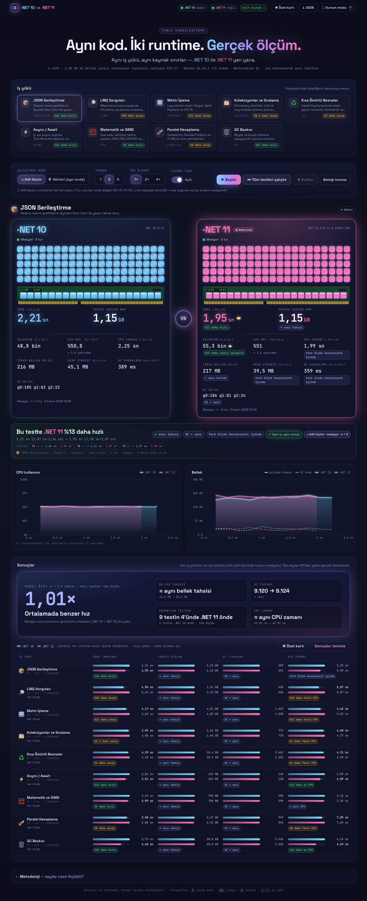
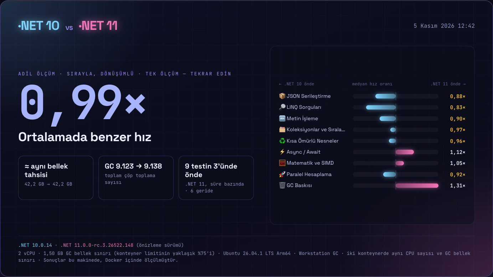
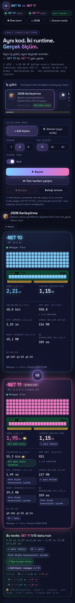

# .NET 10 vs .NET 11 - Canlı Benchmark Karşılaştırması

Bu proje, **aynı C# kodunun** `net10.0` ve `net11.0` hedefleriyle derlenip iki ayrı Docker konteynerinde
**birebir aynı CPU ve bellek limitleriyle** çalıştırıldığı bir demodur. Bir dashboard, seçilen iş yükünü
(workload) iki runtime'da çalıştırır ve **süre, CPU, tahsis edilen bellek ve GC davranışını** canlı olarak yan yana gösterir.

- Her iki imaj da aynı `Dockerfile`'dan üretilir (yalnızca build argümanları farklıdır).
- İki imaj da **aynı işletim sistemi tabanında** çalışır: Ubuntu 26.04 (`10.0-resolute` ve `11.0-resolute` etiketleri). `11.0-noble` etiketi yok; `11.0` varsayılanı 26.04, `10.0` varsayılanı ise 24.04 olduğundan işletim sistemi farkını ortadan kaldırmak için 10 de `-resolute`'a sabitlendi.
- Railway'e dağıtım için bkz. [RAILWAY.md](RAILWAY.md).
- Düz JIT uygulaması: trimming, ReadyToRun, AOT ve `DOTNET_*` ayar değişkenleri **yok**. Her iki runtime kendi varsayılanlarıyla çalışır.
- Ek NuGet paketi yok; yalnızca framework kullanılır.

## Hızlı başlangıç

Gereksinimler: Docker Desktop (compose v2+). Host'ta .NET SDK gerekmez; derleme Docker içinde yapılır.

```bash
./scripts/up.sh --open
```

| Adres | Açıklama |
|---|---|
| http://localhost:8088 | Dashboard (nginx; `/bench10/` ve `/bench11/` yollarını API'lere proxy'ler) |
| http://localhost:5010 | .NET 10 API (`/healthz`, `/api/info`, `/api/workloads`) |
| http://localhost:5011 | .NET 11 API |

Limitleri değiştirmek (her iki konteynere de aynı uygulanır):

```bash
BENCH_CPUS=4 BENCH_MEM=4g ./scripts/up.sh
```

Varsayılanlar: `BENCH_CPUS=2`, `BENCH_MEM=2g` (swap kapalı: `memswap_limit` = `mem_limit`).

Diğer scriptler:

```bash
./scripts/smoke.sh        # json iş yükünü her runtime'da SIRAYLA çalıştırır, result olayını yazdırır
./scripts/logs.sh bench11 # logları izle
./scripts/down.sh         # her şeyi durdur ve kaldır
```

## Ekran görüntüleri

Canlı karşılaştırma (3 tur, medyan):



16:9 özet kartı:



Mobil görünüm:



## İş yükleri (workloads)

| Id | Ne yapar |
|---|---|
| `json` | Nesne grafiklerini System.Text.Json ile serileştirir / deserileştirir. |
| `linq` | Büyük koleksiyonlar üzerinde LINQ zincirleri (filtre, grupla, sırala, topla). |
| `strings` | String birleştirme, ayırma, arama, biçimlendirme ve Span tabanlı işlemler. |
| `collections` | `List`, `Dictionary`, `HashSet` vb. koleksiyonlarda ekleme / arama / dolaşma. |
| `alloc-churn` | Çok sayıda kısa ömürlü nesne üretir; tahsis ve gen0 GC baskısını ölçer. |
| `async` | Çok sayıda `Task` / `async` / `await` zinciri ve scheduler yükü. |
| `math-simd` | Sayısal döngüler ve `Vector<T>` / SIMD kullanan hesaplamalar. |
| `parallel` | `Parallel.For` / thread pool ile CPU çekirdeklerine yayılan iş. |
| `gc-pressure` | Uzun ömürlü ve büyük nesnelerle gen1/gen2 ve LOH baskısı oluşturur. |

Her iş yükü iki runtime'da da **aynı işi** yapar ve bir **checksum** üretir; checksum'ların eşit olması aynı hesabın yapıldığını kanıtlar.

## Metrikleri okumak

- **Süre**: iş yükünün ölçülen kısmının duvar saati süresi (warmup turları hariç). Düşük olan daha iyidir.
- **Tahsis edilen RAM**: `GC.GetTotalAllocatedBytes` farkı; çalışma sırasında heap'e tahsis edilen toplam bayt. Düşük değer daha az GC baskısı demektir.
- **GC g0 / g1 / g2**: çalışma sırasında gerçekleşen nesil 0 / 1 / 2 çöp toplama sayıları. Çoğu zaman g0 >> g1 >> g2 beklenir.
- **CPU %**: işlem CPU süresinin geçen süreye oranı (konteyner limitine göre; 2 CPU'da `%200` tam doygunluktur).
- **GC duraklama**: GC nedeniyle uygulama thread'lerinin durduğu toplam süre.

## Adil ölçüm için ipuçları

- En temiz sayılar için dashboard'daki **"Sırayla"** modunu kullanın (iki runtime aynı anda değil, biri bittikten sonra diğeri çalışır; böylece birbirlerinin CPU'sunu çalmazlar).
- Diğer ağır uygulamaları (IDE, tarayıcı sekmeleri, derlemeler) kapatın.
- Her iş yükünü **iki kez** çalıştırıp **ikinci** sonucu alın (ilk çalışma JIT ısınması ve cache etkisi içerir).
- macOS'ta Docker Desktop bir Linux VM içinde çalışır; mutlak sayılar bare-metal'den farklı olur. Karşılaştırmayı **göreceli** okuyun.
- Checksum'lar aynı işin yapıldığını kanıtlar; eşit değilse sonuca güvenmeyin.
- `BENCH_CPUS` değerini Docker Desktop'ta VM'e ayrılan CPU sayısından büyük seçmeyin.

## Ölçüm doğruluğu hakkında dürüst not

Aşağıdakiler yazarın Mac'inde (Docker Desktop, 10 vCPU'lu VM, her konteyner için limit 2 CPU / 2 GB) ölçülmüştür:

- **Gürültü tabanı:** *Aynı* .NET 10 imajından üretilmiş, aynı limitlere sahip iki konteyner, ardışık 3 turluk medyan testinde iş yüküne göre **+%1 ile +%49 arasında (ortalama +%18)**, eşzamanlı testte ise **−%1,5 ile +%44 arasında (ortalama +%8,7)** farklı çıktı. Yani bu makinede **tek bir iş yükündeki ~%20-25'in altındaki farklar gürültüden ayırt edilemez.**
- Bu testler sırasında host yük ortalaması **5-29** idi (Chrome, IDE'ler, bir VM ve diğer konteynerler çalışıyordu).
- .NET 10 ile .NET 11.0.0-rc.3 arasındaki A/B sonuçları **küçüktü**: süre ortalaması sıralı testte ≈ −%3, eşzamanlıda ≈ −%1; tahsis edilen bayt neredeyse eşit (yalnızca `parallel` ≈ −%2); `strings` iş yükünde .NET 11'de daha az gen1/gen2 GC görüldü. Bu nedenle sonuçlar **gösterge niteliğindedir, kesin değildir**.

Öneriler:

- Ağır uygulamaları (tarayıcı, IDE, VM, diğer konteynerler) kapatın.
- **"Adil ölçüm"** modunu en az **3-5 tekrar** ile kullanın.
- Dashboard'daki **"fark ölçüm hassasiyeti içinde"** çiplerini harfi harfine okuyun: o fark gürültüden ayrılamıyor demektir.
- Veriden fazlasını asla iddia etmeyin.

## Sınırlamalar

- **.NET 11 şu anda bir release candidate**'tir (örneğin `11.0.0-rc.3`). Tam sürüm numarası için `http://localhost:5011/api/info` adresine bakın. Final sürümde sayılar değişebilir.
- Tek makine, tek çalıştırma ile yapılan, mikro-benchmark tarzı bir demodur; **BenchmarkDotNet'in yerini tutmaz** (istatistiksel analiz, izolasyon ve çok iterasyon yok).
- Sonuçlar donanıma ve iş yüküne göre değişir.
- "10000 kat daha az tahsis ediyor" gibi başlıklar **iş yüküne özgüdür**: JIT'in escape analysis'i, metottan kaçmayan nesnelerin tahsisini tamamen ortadan kaldırabilir. Bu, her koda genellenemez.

## Proje yapısı

```
.
├── Dockerfile               # iki runtime için ortak, çok aşamalı (build argümanları ile)
├── Dockerfile.bench10/11    # Railway için bench imajları
├── Dockerfile.dashboard     # Railway için dashboard (nginx + gömülü statik dosyalar)
├── docker-compose.yml       # bench10, bench11, dashboard
├── docker-compose.railway.yml  # Railway'e içe aktarma (bkz. RAILWAY.md)
├── RAILWAY.md               # Railway dağıtım kılavuzu
├── .dockerignore / .gitignore
├── deploy/
│   ├── nginx.conf           # statik dashboard + SSE uyumlu reverse proxy (yerel compose)
│   └── nginx.conf.template, *.envsh, railway-local.override.yml  # Railway dashboard imajı
├── scripts/
│   ├── up.sh                # derle, başlat, sağlık kontrolü (--open ile tarayıcıda aç)
│   ├── down.sh
│   ├── logs.sh
│   └── smoke.sh             # json iş yükünü sırayla çalıştırır
├── src/Bench.Api/           # ASP.NET Core minimal API: benchmark motoru
│   └── Workloads/           # IWorkload uygulamaları
└── dashboard/               # statik HTML/JS ön yüz
```

Konteyner ayrıntıları: imajlar `dotnet-bench:10` ve `dotnet-bench:11`; konteynerler `bench10`, `bench11`, `bench-dashboard`. Uygulama konteyner içinde varsayılan olarak `8080` portunu dinler (öncelik: `ASPNETCORE_URLS` > `PORT` > `8080`).

## Sorun giderme

- **Port meşgul** (`5010`, `5011` veya `8088`): `lsof -i :8088` ile kullananı bulun ya da `docker-compose.yml` içindeki port eşlemesini değiştirin.
- **Loglar**: `docker compose logs bench10`, `docker compose logs bench11`, `docker compose logs dashboard` (veya `./scripts/logs.sh`).
- **İmajları elle çekmek**:
  ```bash
  docker pull mcr.microsoft.com/dotnet/sdk:10.0-resolute
  docker pull mcr.microsoft.com/dotnet/aspnet:10.0-resolute
  docker pull mcr.microsoft.com/dotnet/sdk:11.0-resolute
  docker pull mcr.microsoft.com/dotnet/aspnet:11.0-resolute
  docker pull nginx:1.27-alpine
  ```
- **Sıfırdan derleme**: `docker compose build --no-cache`.
- **Dashboard açılıyor ama veri gelmiyor**: `curl localhost:5010/healthz` ve `curl localhost:5011/healthz` komutları `ok` dönmeli. nginx, bench konteynerleri hazır olmadan da başlar; bir süre sonra sayfayı yenileyin.
- **Konteyner OOM ile öldü**: `BENCH_MEM` değerini artırın (örneğin `BENCH_MEM=4g`); `gc-pressure` yüksek bellek kullanır.

## Yeni bir iş yükü eklemek

1. `src/Bench.Api/Workloads/` altında `IWorkload` arayüzünü uygulayan yeni bir sınıf oluşturun (id, görünen ad, açıklama ve işi yapan metot; sonucu doğrulamak için bir checksum döndürün).
2. Sınıfı, mevcut iş yüklerinin kayıt edildiği yere (workload registry / DI kaydı) ekleyin; mevcut kayıt desenine bakmak yeterlidir.
3. İş mantığının iki runtime'da da **deterministik ve aynı** olduğundan emin olun (sabit seed, aynı girdi boyutu).
4. `./scripts/up.sh` ile yeniden derleyin; yeni iş yükü `/api/workloads` listesinde ve dashboard'da görünür.
